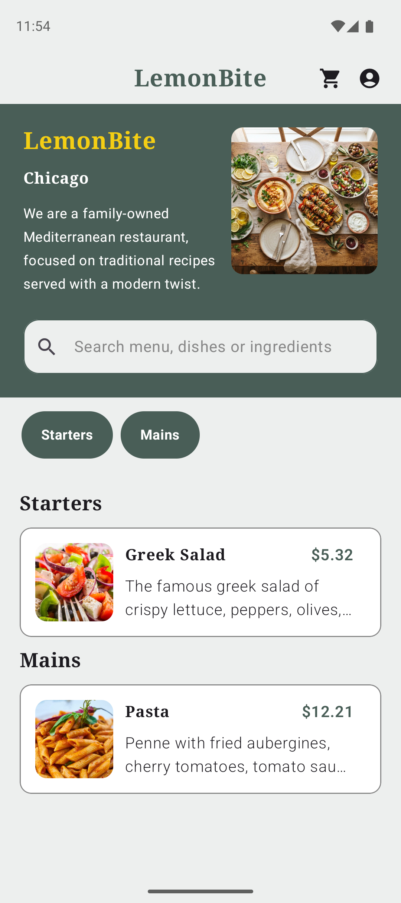
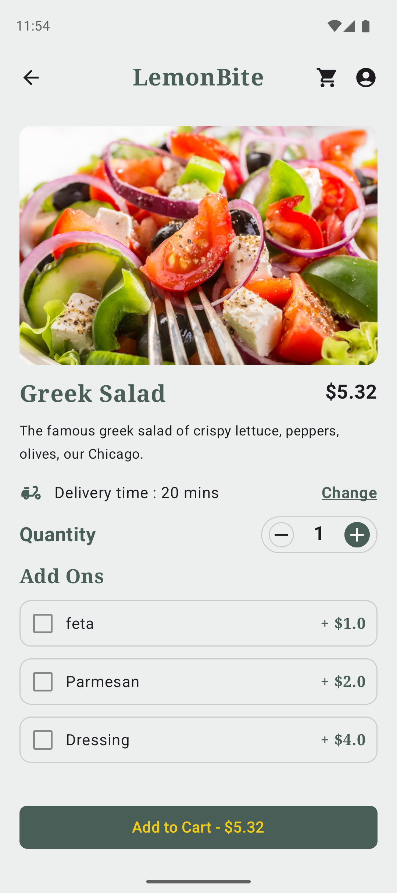
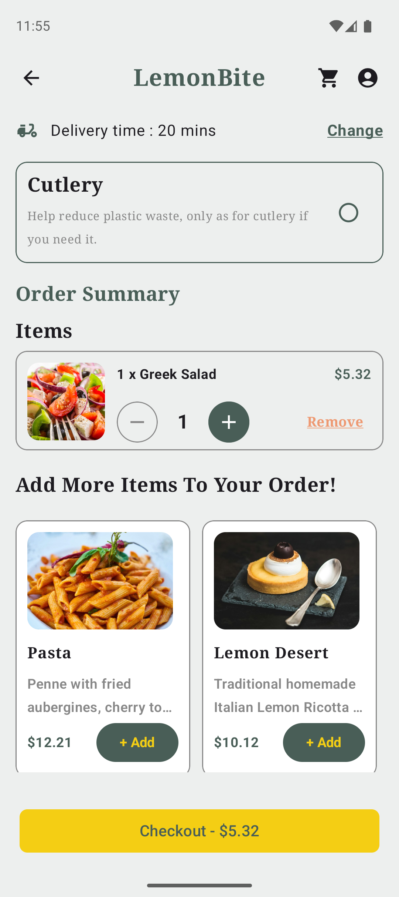
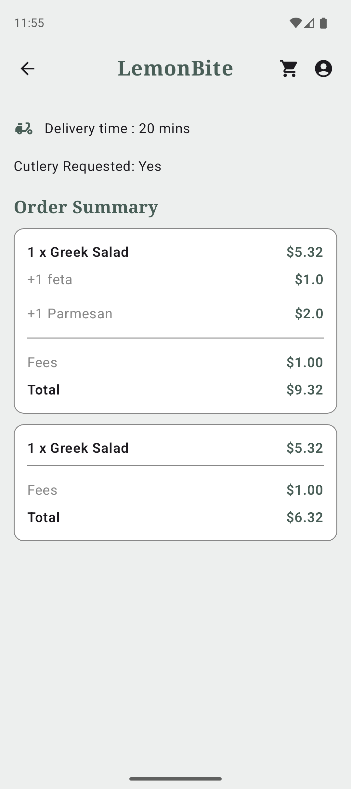
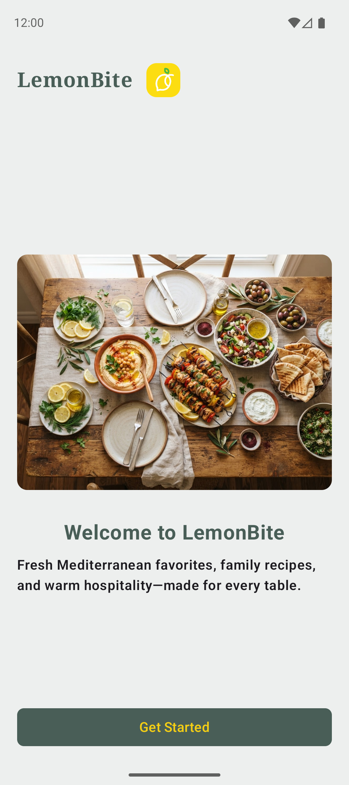
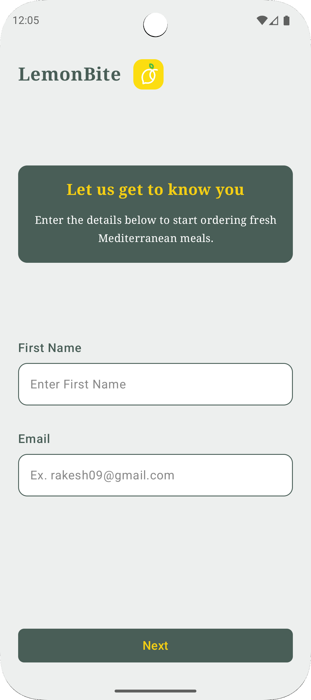
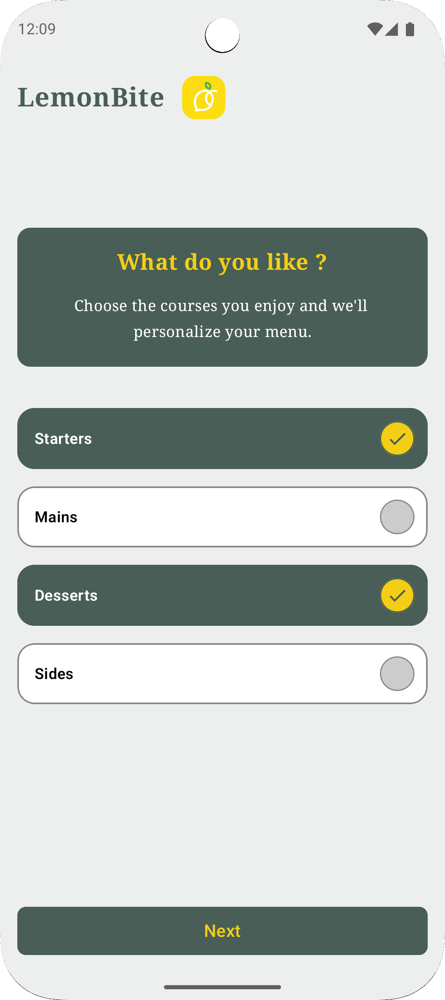

# LemonBite 🍋🍽️

**LemonBite** is a modern, responsive food delivery and ordering Android application built with Jetpack Compose, Kotlin Coroutines, Room Database, Dagger Hilt, and Firebase Firestore following Clean Architecture and MVVM design patterns.

---

## 📱 Features

- 🍕 **Menu Browsing & Search**: Explore categories and menu items fetched dynamically from Firebase Firestore.
- 🥗 **Dish Details & Customization**: Customize dishes with selectable add-ons, quantity selectors, and real-time total price calculation.
- 🛒 **Cart Management**: Add items to cart, modify item quantities, remove items, and maintain cart state locally using Room Database.
- 📦 **Order Placement & Tracking**: Place orders, persist order history offline via Room DB (`OrderEntity`), and view order details on the Track Order screen.
- 👤 **User Profile & Preferences**: Manage user preferences persisted via Jetpack DataStore Preferences.
- 🎨 **Modern Material 3 UI**: Declarative Jetpack Compose UI with dark/light themes, custom components, splash screen, and smooth navigation.

---

## 📸 App Screenshots

| Home Screen | Dish Details | Order Summary |
| :-: | :-: | :-: |
|  |  |  |

| Track Order | Profile Screen | SignUp Screen |
| :-: | :-: | :-: |
|  |  |  |

| Preferences Screen |
| :-: |
|  |

---

## 🛠️ Tech Stack & Architecture

LemonBite is built following **Clean Architecture** principles and **MVVM (Model-View-ViewModel)** pattern, splitting code into modular layers: `presentation`, `domain`, and `data`.

### Architecture Overview

```
com.rm.lemonbite
├── data
│   ├── local          # Room Database (LemonBiteDatabase, DAOs, Entities) & DataStore
│   ├── mapper         # DTO to Domain Data Mappers
│   └── remote         # Firebase Firestore API & Repositories
├── di                 # Dagger Hilt Modules (AppModule, AppRepoModule)
├── domain
│   ├── models         # Pure Kotlin Domain Models (MenuItem, AddOnItem, OrderDetails)
│   └── repository     # Abstract Repository Interfaces (CartRepository, OrderRepository, MenuRepository)
├── presentation
│   ├── customComponents # Reusable Compose Components (TopMenuBar, TextFields, Headings)
│   ├── navigation     # Navigation Compose Graph & Type-Safe Routes
│   ├── screens        # UI Composables & ViewModels (Home, DishDetail, OrderSummary, TrackOrder, Profile)
│   └── utils          # UI State Wrappers (UiState<T>)
└── ui/theme           # Material 3 Color, Type, and Theme definitions
```

### Core Libraries & Technologies

- **Language**: [Kotlin](https://kotlinlang.org/) (2.2.10)
- **UI Framework**: [Jetpack Compose](https://developer.android.com/jetpack/compose) with **Material 3**
- **Navigation**: [Navigation Compose](https://developer.android.com/guide/navigation/design) (Type-Safe Navigation Routes)
- **Dependency Injection**: [Dagger Hilt](https://developer.android.com/training/dependency-injection/hilt-android)
- **Local Database**: [Room Database](https://developer.android.com/training/data-storage/room) (with KSP)
- **Preferences**: [Jetpack DataStore Preferences](https://developer.android.com/topic/libraries/architecture/datastore)
- **Remote Database**: [Firebase Firestore](https://firebase.google.com/docs/firestore) & Play Services Coroutines
- **Image Loading**: [Coil Compose](https://coil-kt.github.io/coil/compose/)
- **JSON Serialization**: [Kotlinx Serialization](https://github.com/Kotlin/kotlinx.serialization)
- **Concurrency**: Kotlin Coroutines & `StateFlow` / `SharedFlow`
- **Annotation Processor**: [KSP (Kotlin Symbol Processing)](https://kotlinlang.org/docs/ksp-overview.html)

---

## 🚀 Getting Started

### Prerequisites

- **Android Studio**: Ladybug (2024.2.1) or newer
- **JDK**: Java 17 or higher
- **Android SDK**: `compileSdk = 37`, `minSdk = 24`, `targetSdk = 36`
- **Firebase Project**: A valid `google-services.json` file placed in the `app/` directory (for Firestore integration)

### Installation & Setup

1. **Clone the Repository**:
   ```bash
   git clone https://github.com/your-username/LemonBite.git
   cd LemonBite
   ```

2. **Add Firebase Configuration**:
   Place your `google-services.json` file inside the `app/` directory:
   ```
   LemonBite/app/google-services.json
   ```

3. **Build the Project**:
   Open the project in Android Studio, allow Gradle to sync dependencies, and run:
   ```bash
   ./gradlew assembleDebug
   ```

4. **Run on Emulator / Physical Device**:
   ```bash
   ./gradlew installDebug
   ```

---

## 🧪 Testing

Run unit tests:
```bash
./gradlew :app:testDebugUnitTest
```

---

## 📜 License

```
Copyright (c) 2026 LemonBite.

Licensed under the Apache License, Version 2.0 (the "License");
you may not use this file except in compliance with the License.
You may obtain a copy of the License at

    http://www.apache.org/licenses/LICENSE-2.0

Unless required by applicable law or agreed to in writing, software
distributed under the License is distributed on an "AS IS" BASIS,
WITHOUT WARRANTIES OR CONDITIONS OF ANY KIND, either express or implied.
See the License for the specific language governing permissions and
limitations under the License.
```
